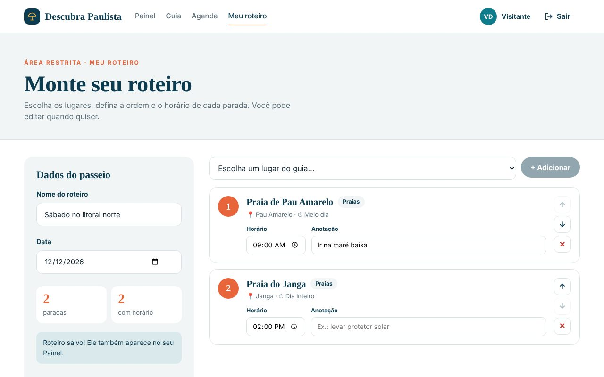
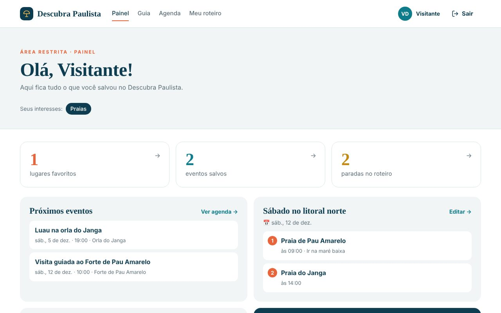

# Descubra Paulista

Projeto da disciplina de Front-End Frameworks (Uninassau), feito pelo Grupo 9. Tema 4: Turismo, Cultura e Lazer.

- Site publicado: https://descubra-paulista.vercel.app
- Trello: https://trello.com/b/yf9iLEdc
- Conta para testar: `demo@paulista.com` / `123456`


## Problema

Paulista tem praia, forte histórico e cultura popular, mas a informação sobre o que fazer na cidade está espalhada. Os pontos turísticos aparecem soltos em rede social e site desatualizado, os eventos são divulgados em cima da hora e quem trabalha com cultura local tem pouco espaço para aparecer.

## Objetivo

Fazer um site que junte em um lugar só os pontos turísticos, os eventos da cidade e uma forma simples de montar um roteiro de passeio. Para salvar favoritos, eventos e roteiro, o usuário precisa criar uma conta.

## Funcionalidades

**Acesso**
- Cadastro com validação dos campos (nome, e-mail, senha com no mínimo 6 caracteres, confirmação e e-mail já cadastrado)
- Login simulado
- Recuperação de senha simulada, em três etapas
- Área restrita: Painel, Guia, Agenda e Meu roteiro só abrem com login
- Logout pelo botão "Sair"

**Do tema**
- Guia turístico: busca, filtro por categoria, detalhes do lugar e favoritos
- Agenda de eventos: busca, filtro por tipo e por mês, opção de ver só os gratuitos e salvar eventos
- Meu roteiro: formulário para criar e editar um roteiro, escolhendo os lugares, a ordem, o horário e uma anotação para cada parada
- Painel: mostra o que o usuário salvou no Guia, na Agenda e no Roteiro, e sugere lugares de acordo com os interesses escolhidos no cadastro

Não existe back-end. Os usuários e os dados ficam no `localStorage` do navegador e todos os dados são fictícios.

| Guia | Agenda |
|---|---|
|  |  |
| **Meu roteiro** | **Painel** |
|  |  |

### O que ficou de fora

O mapa interativo e a vitrine para empreendedores estavam no Backlog, mas não entraram nesta versão. O mapa dependia de uma biblioteca externa e de chave de API, então priorizamos a agenda de eventos. A vitrine precisaria de back-end para cadastrar e moderar os anúncios.

## Tecnologias

- React com Vite
- React Router (rotas e rota protegida)
- Context API para a sessão (`AuthContext`) e para os dados do usuário (`UserDataContext`)
- CSS puro
- Deploy na Vercel

Componentes reutilizáveis que criamos: `Button`, `FormField`, `AuthLayout`, `PageHeader`, `SearchBox`, `FilterChips`, `EmptyState`, `PlaceCard`, `EventCard`, `RoteiroItem`, `StatCard`, `Navbar` e `Footer`.

## Como rodar

Precisa do Node.js 20 ou mais novo.

```bash
git clone https://github.com/Luisggui1227/descubra-paulista.git
cd descubra-paulista
npm install
npm run dev
```

Depois é só abrir o endereço que aparece no terminal (normalmente http://localhost:5173).

## Créditos das fotos

- Forte de Pau Amarelo: Fabiana Barbosa do N. Silva, [Wikimedia Commons](https://commons.wikimedia.org/wiki/File:Forte_de_Pau_Amarelo_Paulista_PE.jpg), licença CC BY-SA 4.0
- Praia de Conceição: Umbraosm, [Wikimedia Commons](https://commons.wikimedia.org/wiki/File:Praia_nossa_senhora_da_concei%C3%A7%C3%A3o_paulista_pernambuco.jpg), licença CC BY-SA 4.0
- Maria Farinha: Jobosco, [Wikimedia Commons](https://commons.wikimedia.org/wiki/File:Maria_Farinha_Paulista_(Pernambuco).jpg), licença CC BY-SA 4.0
- Orla, Pau Amarelo e Janga: fotos do grupo

As fotos do Wikimedia foram redimensionadas para a web.

## Integrantes

- Luis Guilherme de Moraes Melo: estrutura do projeto, login, rota protegida e deploy
- Arthur Ramos Pita: cadastro e Meu roteiro
- Esdras Victor Carvalho da Silva: recuperação de senha e agenda de eventos
- Kelvys Marcelo Soares Silva: navbar com logout, página inicial e painel
- Kauã Henrique de Lima Santos: guia turístico e testes

Algumas partes foram enviadas ao GitHub pelo Luis, porque os integrantes não conseguiram subir a tempo. Isso está registrado nos cartões do Trello.

Cada funcionalidade foi feita em uma branch própria e entrou na `main` por Pull Request (PRs #1 a #10). Os testes dos fluxos principais estão em [docs/TESTES.md](docs/TESTES.md) e as tarefas no Trello.
