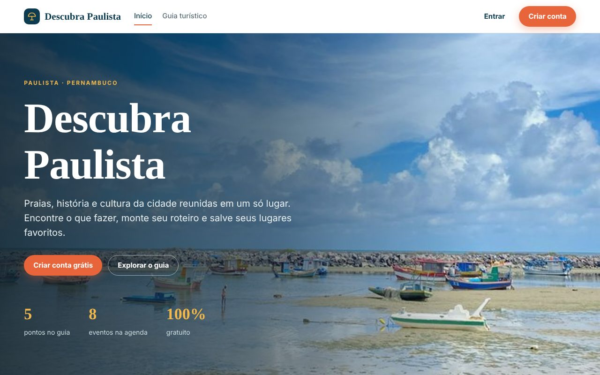
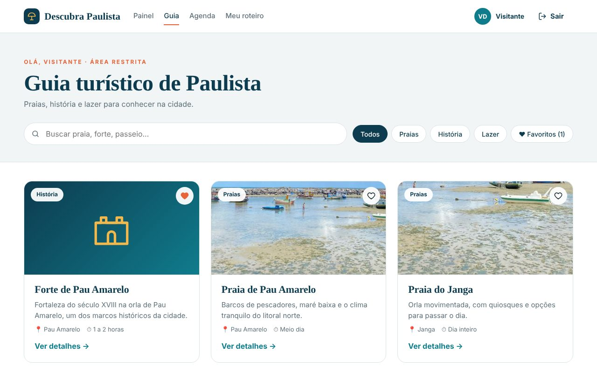
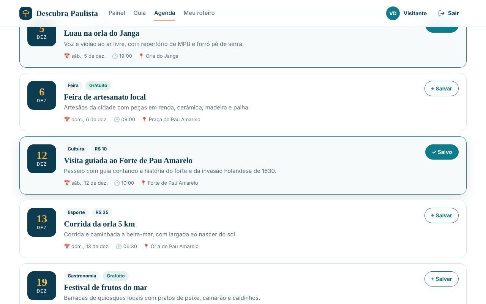
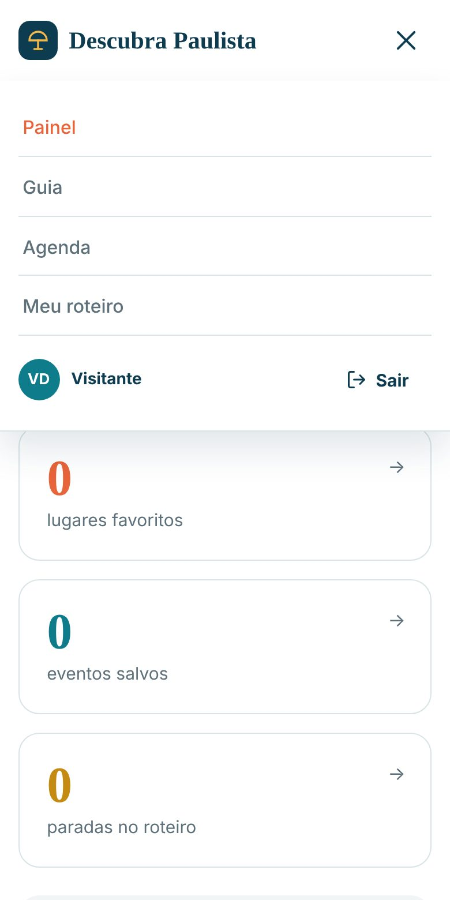

# 🏖️ Descubra Paulista

> Turismo, cultura e lazer da cidade do Paulista (PE) na palma da mão.

Projeto da disciplina **Front-End Frameworks** — Uninassau
**Grupo 9 • Tema 4 — Turismo, Cultura e Lazer**

| | |
|---|---|
| 🌐 **Aplicação publicada** | _link do deploy (Vercel) — preencher após publicar_ |
| 📋 **Quadro do Trello** | https://trello.com/b/yf9iLEdc |
| 💻 **Repositório** | https://github.com/Luisggui1227/descubra-paulista |
| 🔑 **Conta de teste** | `demo@paulista.com` · senha `123456` |



---

## 📌 Problema

Paulista tem praias, patrimônio histórico e cultura popular, mas quem mora ou visita a cidade não encontra essas informações reunidas em um só lugar: os pontos turísticos ficam espalhados em redes sociais, os eventos são divulgados em cima da hora e os pequenos negócios culturais não têm vitrine.

## 🎯 Objetivo

Um aplicativo web que reúne o que fazer em Paulista, com uma área restrita onde o visitante salva lugares favoritos, acompanha a agenda de eventos e monta o próprio roteiro de passeio.

## ✅ Funcionalidades concluídas

### Autenticação e acesso (semana 3)

| Funcionalidade | Rota | Como funciona |
|---|---|---|
| Cadastro de usuário | `/cadastro` | Valida nome, e-mail, senha (mínimo 6, com medidor de força), confirmação e e-mail repetido; guarda os interesses |
| Login simulado | `/login` | Confere e-mail e senha com os usuários fictícios salvos no navegador |
| Recuperação de senha simulada | `/esqueci-senha` | Três passos: e-mail → aviso de envio → nova senha |
| Área restrita | `/painel`, `/guia`, `/agenda`, `/roteiro` | `ProtectedRoute` manda para o login quem não entrou |
| Logout | botão **Sair** | Encerra a sessão e bloqueia de novo a área restrita |

### Funcionalidades do tema (semana 4)

| Funcionalidade | Rota | O que dá para fazer |
|---|---|---|
| **Guia turístico** | `/guia` | Busca, filtro por categoria, detalhes, favoritos e “Adicionar ao roteiro” |
| **Agenda de eventos** | `/agenda` | Busca, filtro por tipo e mês, “só gratuitos”, salvar eventos |
| **Meu roteiro** | `/roteiro` | Formulário para criar e editar o roteiro: nome, data, lugares, ordem, horário e anotação |
| **Painel do usuário** | `/painel` | Junta favoritos, eventos salvos, o roteiro e sugestões pelos interesses do cadastro |

As páginas conversam entre si: o que é favoritado no Guia, salvo na Agenda ou montado no Roteiro aparece no Painel.

| Guia | Agenda |
|---|---|
|  |  |
| **Meu roteiro** | **Painel** |
|  |  |



### Não implementado (mudança de escopo)

| Ideia do Backlog | Motivo |
|---|---|
| Mapa interativo | Exigiria biblioteca de mapas e chave de API; trocado pela Agenda de eventos, que atende melhor ao problema dos “eventos invisíveis” |
| Vitrine para empreendedores | Precisaria de cadastro de terceiros e moderação (back-end); fica para uma próxima versão |

## ⚛️ Recursos do React usados

| Recurso | Onde |
|---|---|
| `useState` | Todos os formulários, filtros, busca, menu do celular e etapas da recuperação de senha |
| Eventos (`onChange`, `onClick`, `onSubmit`) | Formulários, botões de filtro, salvar, mover e remover paradas |
| Renderização condicional | Mensagens de erro, Navbar logada × visitante, listas vazias, etapas da senha |
| Listas com `.map()` e `.filter()` | Lugares, eventos, paradas do roteiro, recursos da home |
| React Router | Rotas públicas e restritas, `NavLink`, redirecionamento após login e logout |
| Context API | `AuthContext` (sessão) e `UserDataContext` (favoritos, eventos e roteiro) |

### Componentes reutilizáveis (com props)

`Button`, `FormField`, `AuthLayout`, `PageHeader`, `SearchBox`, `FilterChips`, `EmptyState`, `PlaceCard`, `EventCard`, `RoteiroItem`, `StatCard`, `Navbar`, `Footer`, `ProtectedRoute`.

## 🛠️ Tecnologias

React + Vite · React Router · Context API · CSS puro com variáveis · Git, GitHub e Trello · Vercel

## 👥 Integrantes

| Integrante | Semana 3 | Semana 4 / final |
|---|---|---|
| Luis Guilherme de Moraes Melo | Estrutura, rotas, contextos, login e rota protegida | Integração, deploy, README e versão v1.0.0 |
| Arthur Ramos Pita | Cadastro com validação | Meu roteiro |
| Esdras Victor Carvalho da Silva | Recuperação de senha | Agenda de eventos |
| Kelvys Marcelo Soares Silva | Navbar com logout e página inicial | Painel do usuário |
| Kauã Henrique de Lima Santos | — | Guia turístico e testes dos fluxos |

## ▶️ Como executar

Pré-requisito: [Node.js](https://nodejs.org/) 20 ou mais recente.

```bash
git clone https://github.com/Luisggui1227/descubra-paulista.git
cd descubra-paulista
npm install
npm run dev
```

Abra o endereço que aparecer no terminal (normalmente http://localhost:5173) e entre com a conta de teste.

```bash
npm run build     # versão de produção em dist/
npm run preview   # serve a versão de produção
npm run lint      # verifica o código
```

> Protótipo sem back-end: os usuários, a sessão e os dados ficam no `localStorage` do navegador. Os dados são fictícios e nenhuma senha real é armazenada.

## 🚀 Deploy

Publicado na Vercel a partir da branch `main`. O arquivo `vercel.json` faz todas as rotas abrirem o `index.html` (necessário para o React Router). Para a Netlify, o arquivo `public/_redirects` faz o mesmo.

## 🔀 Fluxo de trabalho

1. Cada funcionalidade em sua própria branch (`feature/nome`).
2. Pull Request para a `main`, revisado e aprovado por outro integrante.
3. O link do PR vai no cartão do Trello, que passa para **Concluído**.
4. A versão de entrega é marcada com a tag **v1.0.0**.
